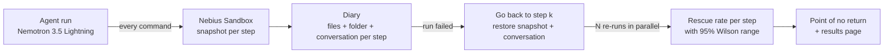

# Rootstep

**Find the step where your AI agent's failure began.**

Rootstep records an AI agent's run with a sandbox save point after every step. When the run
fails, it goes back to earlier save points, lets the agent decide again several times from each,
and measures how often the run could still be saved. Where that number falls to zero and stays
there is the **point of no return**: the step whose decision sealed the run's fate.

**Live demo (real results):** https://sohilp25.github.io/rootstep/

Built for the Nebius x NVIDIA Global AI Hackathon (Coding & Agentic Engineering track) on
**Nebius Token Factory** (Sandboxes + inference) and **NVIDIA Nemotron 3.5 Lightning**.

---

## Why

An agent runs 30 steps and fails. Which step broke it? Today's tools show *what* happened (traces,
logs). Answering *why* usually means an LLM or a person reading the log and guessing. On the
Who&When benchmark, the best log-reading methods pick the right failure step only about 14% of the
time ([arXiv 2505.00212](https://arxiv.org/abs/2505.00212)).

Rootstep doesn't guess from the log. It **runs the experiment**: go back to the exact moment before
step *k* (same files, same conversation), let the agent choose again, and see whether the run can
still succeed. That's an intervention, not a correlation.

Recent research does this only with mocked tools or with environments that can't be restored
(Causal Agent Replay, [arXiv 2606.08275](https://arxiv.org/abs/2606.08275); CausalFlow,
[arXiv 2605.25338](https://arxiv.org/abs/2605.25338)). Rootstep restores the **real** environment
at any step, because Nebius Sandboxes save a snapshot after every command and can fork any of them.

## How it works



1. **Record.** A minimal ReAct terminal agent (one bash command per turn) works inside a Nebius
   Sandbox. After each command we store the new snapshot id, the working folder and the exact
   conversation the model saw.
2. **Go back.** For a chosen step *k*, Rootstep loads the snapshot from just before *k*, restores the
   conversation, and lets the same agent (same model and settings) decide step *k* afresh, N times in
   parallel.
3. **Measure.** Each re-run is checked by the task's own test. The share that succeed is step *k*'s
   **rescue rate**, reported with a 95% Wilson interval, because 3 of 4 is not "exactly 75%".
4. **Decide.** The **point of no return** is the last step where a re-run still succeeded, when every
   later scored step failed every time. The single biggest drop is reported too, flagged when it
   could be luck.

## Real results

All numbers come from real runs on Nebius Token Factory.

### Test 1: a planted mistake, so we know the right answer
We let the agent work on `textstats` (fix two bugs in two files without touching the tests), but at
**step 3** we replaced its decision with a harmless-looking command that adds one blank line to the
test file. The tests still pass, but the rule "don't edit the tests" is broken, so the run must fail,
and the agent can't notice. Rootstep was not told where the mistake was.

| Went back to step | 0 | 1 | 2 | **3** | 4 | 5 | 6 |
|---|---|---|---|---|---|---|---|
| Re-runs that succeeded | 4/4 | 4/4 | 4/4 | **4/4** | 0/4 | 0/4 | 0/4 |

**Rootstep's answer: point of no return = step 3, confident** (the 95% ranges don't overlap).
**It matches the planted step exactly.** 28 re-runs, 108 seconds, $0.07. See it on the
[live demo](https://sohilp25.github.io/rootstep/).

### Test 2: a natural failure, and what it taught us
Earlier, with our first version of the agent, a run failed on its own: it used all 30 steps, looping
`cat cli.py` → `pytest`. Rootstep re-ran it 40 times: going back to step 6 saved it 4 of 4 times,
step 15 1 of 4, and from step 18 on 0 of 16, so the point of no return was steps 15–17 (not yet
confident with only 4 tries per step). A naive "biggest drop" rule would have blamed step 0–2,
fooled by one unlucky 0/4 at step 3.

The diary showed the **root cause**: in 19 of 30 steps the model wrote one command and then *invented*
a whole terminal session after it (a fake `git` history, test files that don't exist, fake pytest
errors), and the agent believed its own inventions. We changed the agent because of this finding
(harness 0.3: replies capped at 600 tokens, only the command that ran is kept in the conversation).

| Agent | Attempts from the start that succeeded |
|---|---|
| First version (0.1) | 6 of 8 (75%) |
| After the fix (0.3) | **9 of 9 (100%)** |

Promising, but a small sample: the 95% ranges still overlap.

### Platform numbers we measured
One agent step ≈ 0.7 s of Nemotron 3.5 Lightning (thinking off) + ≈ 2.3 s for a sandbox command with a
snapshot. Rollback restored the exact earlier state, forks were isolated, and 20 parallel sandboxes
and 20 parallel model calls ran without errors or rate limits. A typical run of the improved agent
costs about $0.001–0.002.

## Quick start

Needs Python 3.11+, a Nebius Token Factory API key and project ID.

```bash
git clone https://github.com/SohilP25/rootstep && cd rootstep
python3 -m venv .venv && source .venv/bin/activate
pip install -r requirements.txt
cp .env.example .env          # fill NEBIUS_API_KEY and NEBIUS_PROJECT_ID

python -m pytest -q           # 34 tests, no network, no cost

python run_agent.py textstats                     # one recorded run (~1 min, < $0.02)
python run_agent.py textstats --plant 3           # a test run with a known mistake at step 3
python analyze.py <run_id> --every 3 --tries 4    # go back and re-run (first pass)
python analyze.py <run_id> --steps 14,15,16,17 --tries 5   # zoom in: adds to earlier tries
python export_site.py                             # build data for the results page
python -m http.server 8000 --directory docs       # open http://localhost:8000
```

Re-run diaries land in `runs/reruns/`, so you can analyze a failed re-run too.

## Project layout

| Path | What it does |
|---|---|
| `rootstep/llm.py` | Token Factory client (OpenAI-compatible) with a hard spending cap |
| `rootstep/sandbox.py` | Nebius Sandboxes: a snapshot per command, folder tracking across fresh shells |
| `rootstep/agent.py` | The minimal terminal agent; can start from any recorded step |
| `rootstep/record.py` | The per-step diary (snapshot, folder, conversation, reply, output, cost) |
| `rootstep/attribute.py` | Re-runs, rescue rates, Wilson intervals, point of no return |
| `rootstep/tasks.py` | Tasks with a pass/fail check (tests are fingerprinted so the agent can't edit them) |
| `run_agent.py`, `analyze.py`, `export_site.py` | Command-line entry points |
| `docs/` | The static results page (GitHub Pages) |
| `tests/` | 34 offline tests with a fake model and fake sandbox |

## Limitations (honest)

- Snapshots cover the filesystem, not running processes, so Rootstep fits agents whose state lives in
  files (coding, terminal, data agents).
- Few re-runs give wide ranges: the results page says "not yet confident" until a zoom-in pass narrows them.
- So far: one task, one planted-mistake test and one agent (our own minimal agent). Re-runs must use
  the exact recorded agent and settings, which Rootstep enforces through the run's saved config and
  harness version.
- Long, repetitive conversations make re-runs from late steps cost more (the natural-failure analysis was $0.92; the planted test, with the improved agent, $0.07).

## What's next

Verified repair suggestions (propose a prompt/tool change, prove it by re-running), an MCP server so
any agent can record through Rootstep, a mini-swe-agent adapter, more tasks with planted mistakes, and
exporting step-level (bad action, rescuing action) pairs for training.

## Related work

- Who&When: automated failure attribution for multi-agent systems, [arXiv 2505.00212](https://arxiv.org/abs/2505.00212)
- Causal Agent Replay: counterfactual attribution, mocked tools, [arXiv 2606.08275](https://arxiv.org/abs/2606.08275)
- CausalFlow: causal attribution and counterfactual repair, [arXiv 2605.25338](https://arxiv.org/abs/2605.25338)
- Counterfact Labs ([GitHub](https://github.com/counterfact-labs/counterfact)): ablates whole agents in LangGraph pipelines
- adamthuvesen/counterfact ([GitHub](https://github.com/adamthuvesen/counterfact)): causal statistics over logged traces, no re-execution

## License

Apache-2.0
